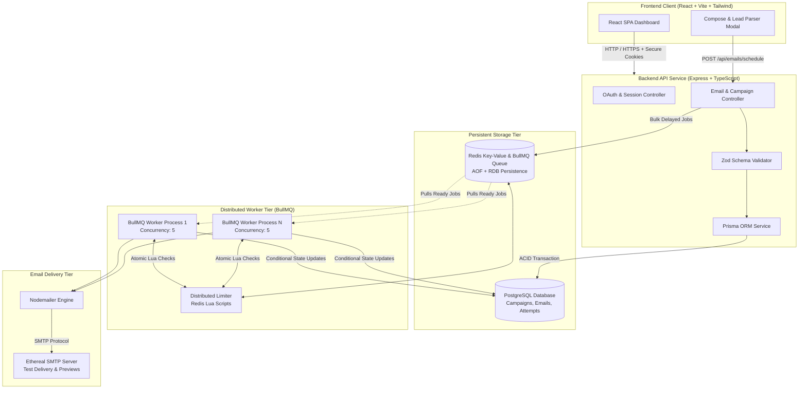
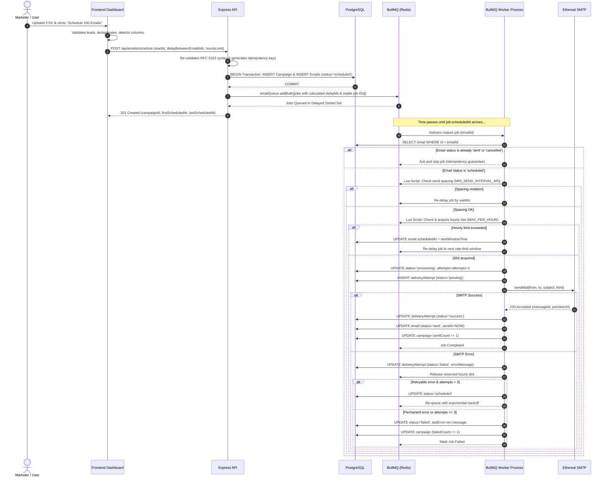

# InboxPilot — System Architecture & Design Specification

InboxPilot is an enterprise-grade, distributed, persistent email scheduling platform engineered for high reliability, strict idempotency, crash resilience, and distributed rate limiting.

---

## 1. High-Level Architecture Diagram



---

## 2. Scheduling & Execution Sequence Diagram



---

## 3. Distributed Rate Limiting & Concurrency Controls

### 3.1 Worker Concurrency (`WORKER_CONCURRENCY`)
`WORKER_CONCURRENCY` defines how many parallel BullMQ jobs a single worker node will pull from Redis concurrently (default: `5`). Concurrency allows the node to saturate non-blocking I/O during network transmissions.

### 3.2 Minimum Send Spacing (`MIN_SEND_INTERVAL_MS`)
Even with high concurrency, sending multiple emails to mail transfer agents (MTAs) from the same sender in the exact same millisecond triggers spam filters.
- **Coordination**: Distributed Redis key `spacing:sender:{senderId}`.
- **Lua Script**:
  ```lua
  local key = KEYS[1]
  local now = tonumber(ARGV[1])
  local min_interval_ms = tonumber(ARGV[2])

  local last_sent = redis.call('GET', key)
  if last_sent then
    local diff = now - tonumber(last_sent)
    if diff < min_interval_ms then
      return {0, min_interval_ms - diff}
    end
  end
  redis.call('SET', key, now, 'PX', min_interval_ms * 4)
  return {1, 0}
  ```
- **Behavior**: If two workers pull jobs for the same sender within 500ms when `MIN_SEND_INTERVAL_MS=2000`, the second worker is returned `{0, 1500}`. If the wait is `<= 2000ms`, the worker sleeps inline; if longer, it reschedules the job in BullMQ without dropping it.

### 3.3 Distributed Hourly Rate Limiting (`MAX_EMAILS_PER_HOUR_PER_SENDER`)
- **Key**: `ratelimit:hourly:{senderId}` (Redis Sorted Set).
- **Algorithm**: Rolling 3600-second sliding window via Redis Lua script:
  1. `ZREMRANGEBYSCORE key -inf (now - 3600000)` removes sends older than 1 hour.
  2. `ZCARD key` counts sends within the current 1 hour.
  3. If `count < limit`, `ZADD key now emailId` atomically reserves the slot.
  4. If `count >= limit`, the oldest timestamp in the window is read (`ZRANGE key 0 0 WITHSCORES`). The script calculates exact `retryAfterMs = (oldestTimestamp + 3600000) - now`.
  5. The job is rescheduled into BullMQ via `job.moveToDelayed(now + retryAfterMs)` and `email.scheduledAt` is updated in PostgreSQL.

---

## 4. Idempotency & Crash Recovery Mechanics

### 4.1 Unique Idempotency Keys
- **Campaign**: Unique constraint on client idempotency key or generated UUID.
- **Email**: Unique database constraint on `idempotencyKey` (`campaignId:recipientEmail`).
- Prevents double-scheduling even if the frontend triggers multiple retries on flaky Wi-Fi.

### 4.2 Stable BullMQ Job IDs
Every BullMQ job has its ID explicitly assigned as `email:${email.id}`. BullMQ guarantees that Redis cannot hold two jobs with the same ID, preventing duplicate queue insertion.

### 4.3 Safe State Machine
State transitions are strictly one-way:
$$\text{scheduled} \longrightarrow \text{processing} \longrightarrow \begin{cases} \text{sent} & (\text{terminal}) \\ \text{failed} & (\text{terminal}) \\ \text{cancelled} & (\text{terminal}) \end{cases}$$

- If an email is already `sent`, redelivered jobs immediately exit without re-sending.
- If an email was `cancelled`, worker skips dispatch and acknowledges job.

### 4.4 The SMTP Ambiguity Window
No distributed system can atomically commit an SMTP submission and an external PostgreSQL database write in a single two-phase transaction without provider-level two-phase commit:
- If Ethereal accepts the message (250 OK) and the node suffers catastrophic hardware power failure in the 5ms before the DB update completes, the email was physically delivered, but PostgreSQL still records it as `processing`.
- **Mitigation**: Delivery attempts record `startedAt` before transmission. Upon reboot, reconciliation identifies stuck `processing` jobs, checks provider receipts, and avoids blind re-transmissions.
